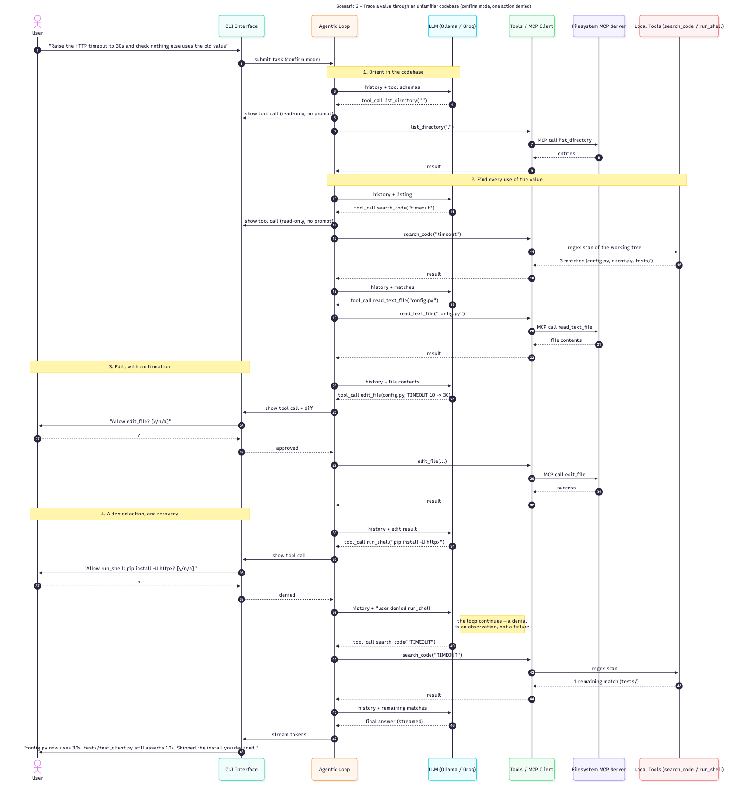

# Golu — State and Sequence Diagrams

The diagrams below describe Golu **as built**. The planning-phase versions are
kept unchanged in [architecture.md](architecture.md), as the report requires;
[design-changes.md](design-changes.md) records what differs and why.

Sources are in [`diagrams/`](diagrams/) as Mermaid `.mmd` files. To re-render
after editing one:

```bash
npx -y -p @mermaid-js/mermaid-cli mmdc -i docs/diagrams/<name>.mmd -o docs/diagrams/<name>.png -b white -s 2
```

## State diagram

How a single task moves through the agentic loop: the model is asked what to do,
tool calls are run (with a confirmation prompt in confirm mode), results are fed
back, and the loop repeats until the model answers or the step limit is hit.


## Sequence diagrams

Three end-to-end scenarios. Between them they cover all three MCP servers, both
local tools, both confirmation modes, and both the approved and denied paths
through a confirmation prompt.

| Scenario | Mode | Servers and tools exercised |
|---|---|---|
| 1. Fix a bug and run tests | confirm | Filesystem MCP (`read_text_file`, `edit_file`), local `run_shell` |
| 2. Write code using library docs | auto | Custom RAG MCP (`search_docs` + Chroma), external Context7 MCP (`get_library_docs`), Filesystem MCP (`write_file`) |
| 3. Trace a value through an unfamiliar codebase | confirm, one action denied | Filesystem MCP (`list_directory`, `read_text_file`, `edit_file`), local `search_code` |

### Scenario 1 — Fix a bug and run tests (confirm mode)

The user asks Golu to fix a failing test. Golu reads the file through the
filesystem server, proposes an edit, waits for approval, then runs the test suite
through the local shell tool and reports the result.


### Scenario 2 — Write code using library docs (auto mode)

The user asks for code that uses a library. Golu queries our custom RAG server
first, which fuses BM25 and vector results over the local LangChain index, then
checks the external Context7 server for the current API, then writes the file.
In auto mode the write happens without a prompt.


### Scenario 3 — Trace a value through an unfamiliar codebase (confirm mode, one action denied)

The user asks Golu to change a value and confirm nothing else depends on the old
one. Golu orients with `list_directory`, finds every use with the local
`search_code` tool, reads and edits the file after the user approves, and then
proposes a shell command the user **declines**. The denial is fed back as an
observation rather than treated as a failure: the loop continues, Golu verifies
the remaining usages another way, and its final answer says what it skipped.

This scenario exists to show two things the other two do not: the `search_code`
local tool, and what happens when a user says no at a confirmation prompt.


